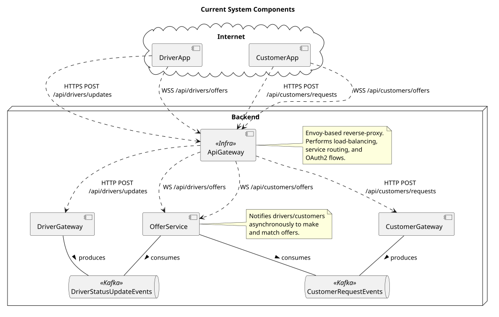
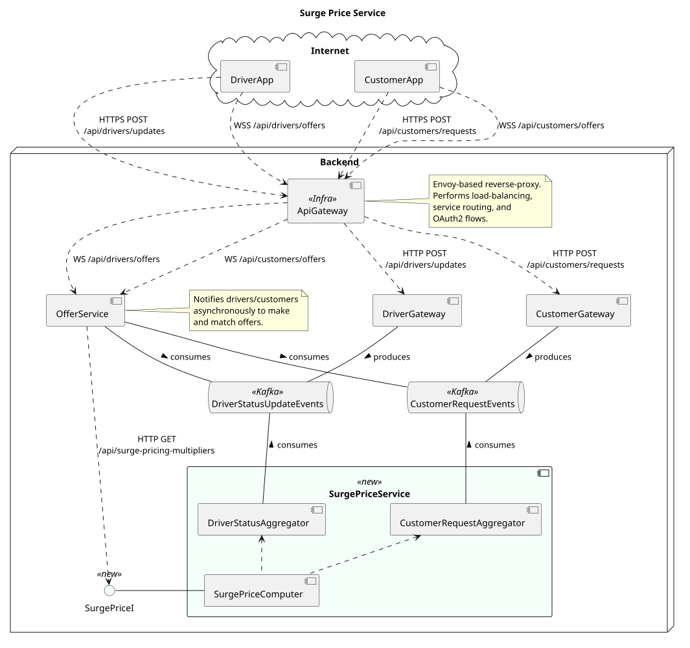
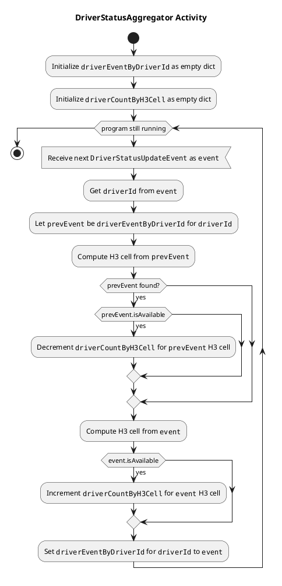
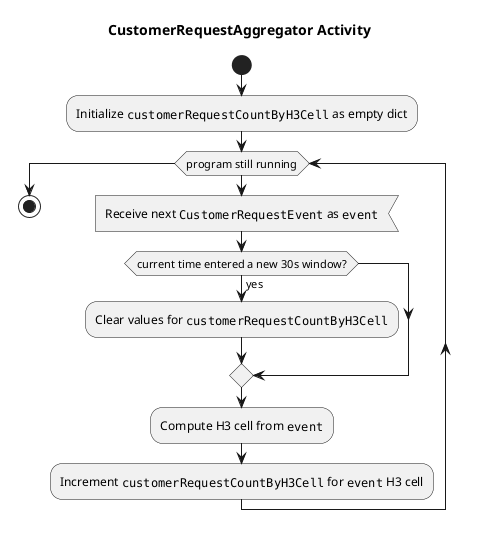
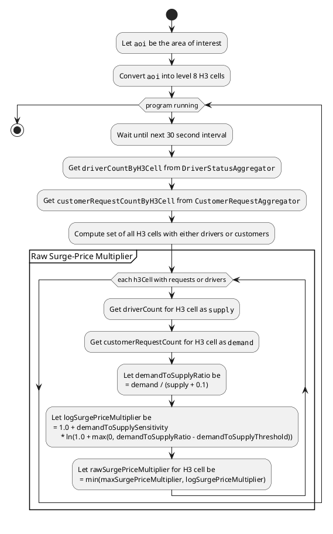

#+TITLE: Ride-Hailing Surge Pricing Service
#+SUBTITLE: version {{{version}}}, last updated {{{updated}}}
#+AUTHOR: Vijay Paul Nayar
#+EMAIL: madric@gmail.com
#+DATE: <2026-11-19 Thu>

#+MACRO: version 0.1.0
#+MACRO: updated <2026-11-19 Thu>
# Configurations for pretty HTML output.
#+SETUPFILE: https://fniessen.github.io/org-html-themes/org/setup/html-theme-readtheorg.setup
#+HTML_HEAD: 
#+HTML_HEAD: 
#+HTML_HEAD: 
#+HTML_HEAD: 
#+HTML_HEAD: 

#+BEGIN_COMMENT
Built using:
+ Emacs: 30.2
  + Org Mode (org): 9.7.11
  + Org Export Git Flavored Markdown (ox-gfm): 20231215.1901
  + Org Babel
+ PlantUML: 1.2026.6
#+END_COMMENT

* Ride-Hailing Surge Pricing Service
  :PROPERTIES:
  :CUSTOM_ID: title
  :END:

* Abstract
  :PROPERTIES:
  :CUSTOM_ID: abstract
  :END:

Customers are interested in finding taxis to transport them to destinations, while taxi drivers are
trying to maximize their earned revenue. Both customers and taxi drivers have no innate knowledge of
the needs of the other, and demand can sometimes be higher than the supply of available taxis,
meaning that some customers should find an alternative route rather than waiting for a taxi. Surge
Pricing is a mechanism to adjust prices according to the ratio of active customer requests to
available taxi drivers by geographic area. Higher prices serve as both a means to attract more taxi
drivers to an area with insufficient supply and a means to encourage users to find alternatives to
reduce demand.

* Background
  :PROPERTIES:
  :CUSTOM_ID: background
  :END:

This document is a software design document that impacts a hypothetical software system for a
ride-hailing app. The document will serve both its normal purpose as context for human engineers, but
also as context for AI systems that can be used to assess how well pull-requests move the current
implementation towards being in compliance with the design.

** System Summary
   :PROPERTIES:
   :CUSTOM_ID: system-summary
   :END:

The company operates a ride-hailing system which brings together two broad classes of users:
- *Customers*: These users are willing to pay money in return for transportation
  services. Everything else in the system revolves around trying to satisfy the needs of the
  customers as well as possible with the available resources.
- *Drivers*: These are independent or taxi businesses that transport customers in return for
  payment. Their goal is to maximize their access to customers in order to maximize their own
  profits.

The ride-hailing system allows customers to use a Customer Mobile App in order to schedule
transportation to their desired location. The benefits to the customer are as follows:
1. *Transparency*: The customer is able to see the total price of the transportation up-front,
   allowing them to decide whether they wish for the service before they commit.
2. *Ease of Use*: Rather than physiclly having to waive a taxi down, the Customer App is connected
   to a system that can bring a driver exactly to a customer's location, even if there are no
   drivers in the immediate vicinity.
3. *Competitive Pricing*: Because multiple independent and taxi businesses agree in advance to take
   customers for a standardized price, the customers effectively benefit from collective
   bargaining. Because drivers get a higher volume and steady stream of customers, the price per
   customer does not need to be as high.

The ride-hailing service also benefits drivers when they use the Driver Mobile App. Their benefits
include:
1. *Higher Profits*: The system can make transportation offers for customers without the driver even
   being at the customer's location (e.g. the customer is still in their home/office, the nearest
   customer is out of sight, or the driver is currently completing another ride). The higher number
   of bookings per day and less time spent searching or waiting for customers translates into higher
   profits.

** Current Components
   :PROPERTIES:
   :CUSTOM_ID: current-components
   :END:

In lieu of a system architecture document, the shape of the system is summarized here.

Normally, the system is composed of the following parts:
- *Driver App*: This is an application for mobile devices owned by taxi drivers. It is responsible
  for allowing drivers to register with the mobility service and announce that they are available to
  accept offers. If DriverApp will also present drivers with offers, which they can choose to
  accept.
- *Customer App*: This is an application for mobile devices owned by the customers. Customers that
  desire transportation from a location to another location can initiate a request, be presented
  with a price, and if the customer accepts, they will be quickly notified if a taxi driver has
  accepted their request.
- *Api Gateway*: This component handles common [[https://en.wikipedia.org/wiki/Reverse_proxy][reverse-proxy]] concerns, such as load-balancing ingress
  requests, TLS termination, rate limiting, etc. It is typically implemented as part of software
  infrastructure using technologies like [[https://kubernetes.io/docs/concepts/services-networking/gateway/][Kubernetes Gateway API]], [[https://www.envoyproxy.io/][Envoy]], [[https://traefik.io/traefik][Traefik]], or even a basic
  [[https://nginx.org/][nginx]] server.
- *Driver Gateway*: The primary purpose of this service is to accept synchronous API calls from
  drivers that update their status as well as location, and convert them into asynchronous Kafka
  messages for downstream processing.
- *Customer Gateway*: The primary purpose of this service is to accept synchronous API calls from
  customers requesting taxi services, including the pickup and dropoff locations, and convert them
  into asynchronous Kafka messages for downstream processing.
- *Offer Service*: This service has several key responsibilities including: presenting customer
  offers with a price for taxi services, prioritizing taxis to fulfill customer reqeusts, contacting
  the DriverApp of taxi drivers until one accepts the offer, and then notifying the customer that
  their request has been assigned.

# The SVG format is used instead of PNG to better allow AI models to understand the text contents.
#+BEGIN_SRC plantuml :file design/current-component-overview.svg :cache yes
title Current System Components

skinparam NodeSep 100

cloud Internet {
  component DriverApp
  component CustomerApp
}

node Backend {
  component ApiGateway <<Infra>>
  note right
    Envoy-based reverse-proxy.
    Performs load-balancing,
    service routing, and
    OAuth2 flows.
  end note

  component DriverGateway
  component CustomerGateway

  queue DriverStatusUpdateEvents <<Kafka>>
  queue CustomerRequestEvents <<Kafka>>

  component OfferService
  note right
    Notifies drivers/customers
    asynchronously to make
    and match offers.
  end note

  DriverApp ..> ApiGateway : HTTPS POST\n /api/drivers/updates
  DriverApp ..> ApiGateway : WSS /api/drivers/offers
  CustomerApp ..> ApiGateway : HTTPS POST\n /api/customers/requests
  CustomerApp ..> ApiGateway : WSS /api/customers/offers

  ApiGateway ..> DriverGateway : HTTP POST\n /api/drivers/updates
  ApiGateway ..> CustomerGateway : HTTP POST\n /api/customers/requests
  ApiGateway ..> OfferService : WS /api/drivers/offers
  ApiGateway ..> OfferService : WS /api/customers/offers

  DriverGateway -- DriverStatusUpdateEvents : produces >
  CustomerGateway -- CustomerRequestEvents : produces >

  OfferService -- CustomerRequestEvents : consumes >
  OfferService -- DriverStatusUpdateEvents : consumes >
}
#+END_SRC

#+RESULTS[dfef0b2be240ce80d5f65b903541b9363498a3b2]:

** The Problem of Demand/Supply Mismatch
   :PROPERTIES:
   :CUSTOM_ID: the-problem-of-demand-supply-mismatch
   :END:

The system currently focuses on satisfying customer requests (demand) by providing offers to
independent or taxi drivers (supply). So long as the level of demand is at or below the level of
supply, this operates smoothly without any problems.

However, when demand exceeds supply in a given geographic vicinity, then customers end up waiting
considerably longer until a driver becomes available. Longer wait times lead to more cancellations,
which creates further chaos. There may be available drivers in nearby or more distant geographic
areas, but for these drivers, getting to the customer's location takes time and lost business
opportunities if a customer makes a request closer to their location. This problem is especially
exacerbated when a surge in demand happens in a single geographic area, for example, due to a
sporting event, a convention, political event, or celebration.

When customers try to use the app, but cannot secure transportation, it undermines their confidence
in the system overall. Likewise, if drivers feel that they cannot earn enough profit to justify
their expenses, especially if they only see offers quite far from their current location, then this
undermines the their confidence in the system as well.

** Influencing Demand and Supply
   :PROPERTIES:
   :CUSTOM_ID: influencing-demand-and-supply
   :END:

In order to address the problem of a mismatch between supply and demand, the system architecture has
been modified so that dynamic or surge pricing may be used as an incentive to both customers and
drivers to address the mismatch in demand vs. supply.

When the ratio between demand and supply in a geographic area grows large, increasing the price for
rides beginning within that area has the following effects:
- Some *customers* may be dissuaded by the increased price and seek out alternate forms of
  transportation, thereby decreasing demand.
- Some *drivers* may be incentivized by the higher prices of offers to travel from further away to
  the high-demand area.

As more drivers move to the high demand area, the demand to supply ratio will decrease, and the
surge pricing will accordingly do the same. Thus, using prices as incentives can lead to customers
that get more timely service as well drivers that get compensated for the extra travel they must do
to go to a different area.

** Stability of Surge Pricing
   :PROPERTIES:
   :CUSTOM_ID: stability-of-surge-pricing
   :END:

Dynamic pricing is a sensitive topic, where there can be perceptions of unfairness if it is done
incorrectly. Furthermore, because the prices are meant to influence driver and customer behavior,
the prices must be reasonably predictable and stable to all users. For example, a customer that sees
wildly fluctuating surge prices will not change their behavior or find an alternate means of
transportation, but will simply keep making and cancelling requests until they get lucky and find a
lower price. Likewise, a driver that sees wildly fluctuating surge prices may assume that, by the
time they reach the area with high surge prices, they surge pricing will be gone, and they will not
receive compensation for diverting from their normal area.

Thus in order for surge pricing to achieve its intended effect, it must have a degree of stability
over:
- *Time*: Over the duration of a request and an offer, the surge multiplier should be reasonably stable.
- *Space*: In an area with a high demand to supply ratio, the wrong incentives are created if users
  simply cross the street in order to pursue a lower surge price. Thus, surge prices should be relatively
  stable over areas that are in need of a greater supply of drivers.
- *Demand or Supply Fluctuations*: The ratio of demand to supply can fluctuate rapidly, especially
  when supply is low. Thus a ratio of 2 to 1 might change to 10 to 1, but this should not result in
  a 5x increase in price, but rather a more gradual change.

** New Surge Pricing Service
   :PROPERTIES:
   :CUSTOM_ID: new-surge-pricing-service
   :END:

Rather than adding all the additional complexity of computing surge prices, updating them, and
updating prices directly into the *Offer Service*, the system architecture has been modified so that
these responsibilities are to be performed by a new *Surge Pricing Service*.

At a high level, this new service is expected to have the following interactions with other services:
- *Offer Service*: The Offer Service will periodically query the Surge Pricing Service in order to
  determine the surge price multiplier for a customer ride request, which will not only be used to
  compute a price, but it will also be shown directly to customers (so they are aware that a this is
  a temporary price change, not a permanent one).
- *Driver App*: It should be possible for the drivers to see on a map the surge price
  multipliers. This allows them to make an informed choice about whether they wish to relocate or
  not while providing services.

Creating this as a separate service has several advantages:
1. It allows the more complex formulas and configurations to be independently and modularly tested,
   separate from the already complex logic of the Offer Service.
2. It allows deployment on separate hardware, which is useful because the performance and scaling
   needs may be different from the Offer Service.
3. Keeping the complex logic strictly separate makes live incidents easier to diagnose.

* Requirements
  :PROPERTIES:
  :CUSTOM_ID: requirements
  :END:

1. The Surge Pricing Service *MUST* define a REST API interface usable by the *Driver App* capable
   of showing surge-price multipliers over a geographic area encompassing a circle with
   radius up to 8 kilometers with a resolution between 0.5 and 1.0 square-kilometers.
2. If a geo-spatial system is used to describe geograhic areas, client libraries *MUST* exist for
   the following programming languages: C, Java, JavaScript, and Python.
3. Surge-price multipliers *MUST* have a value between a 1.0 and 5.0.
4. Surge-price multipliers *MUST* be updated at least every 60 seconds.
5. Surge-price multipliers *SHOULD* gradually change (avoid jitter) despite potentially rapid
   fluctuations of incoming requests and available drivers in time and location.

* Method
  :PROPERTIES:
  :CUSTOM_ID: method
  :END:

Information here is presented first at a high-level, with further details coming further below. That
is, it is presented mostly in the reverse order from which it was written.

** Component Overview
   :PROPERTIES:
   :CUSTOM_ID: component-overview
   :END:

This design document describes the introduction of a Surge Pricing Service which is to be added to an
existing system.

The *Surge Pricing Service* will be responsible for consuming ~DriverStatusUpdateEvents~ and
~CustomerRequestEvents~, computing surge-price multipliers over time and location, and offering an API
to get the surge price multiplier for a given location.

# The SVG format is used instead of PNG to better allow AI models to understand the text contents.
#+BEGIN_SRC plantuml :file design/component-overview.svg :cache yes
title Surge Price Service

'skinparam linetype ortho
'skinparam ranksep 100
skinparam NodeSep 100
skinparam InterfaceBackgroundColor<<new>> #MintCream
skinparam ComponentBackgroundColor<<new>> #MintCream

cloud Internet {
  component DriverApp
  component CustomerApp
}

node Backend {
  component ApiGateway <<Infra>>
  note right
    Envoy-based reverse-proxy.
    Performs load-balancing,
    service routing, and
    OAuth2 flows.
  end note

  component DriverGateway
  component CustomerGateway

  queue DriverStatusUpdateEvents <<Kafka>>
  queue CustomerRequestEvents <<Kafka>>

  component SurgePriceService <<new>> {
    component DriverStatusAggregator
    component CustomerRequestAggregator
    component SurgePriceComputer

    DriverStatusAggregator <.. SurgePriceComputer
    CustomerRequestAggregator <.. SurgePriceComputer
  }
  interface SurgePriceI <<new>>
  SurgePriceComputer - SurgePriceI

  component OfferService
  note right
    Notifies drivers/customers
    asynchronously to make
    and match offers.
  end note

  DriverApp ..> ApiGateway : HTTPS POST\n /api/drivers/updates
  DriverApp ..> ApiGateway : WSS /api/drivers/offers
  CustomerApp ..> ApiGateway : HTTPS POST\n /api/customers/requests
  CustomerApp ..> ApiGateway : WSS /api/customers/offers

  ApiGateway ..> DriverGateway : HTTP POST\n /api/drivers/updates
  ApiGateway ..> CustomerGateway : HTTP POST\n /api/customers/requests
  ApiGateway ..> OfferService : WS /api/drivers/offers
  ApiGateway ..> OfferService : WS /api/customers/offers

  DriverGateway -- DriverStatusUpdateEvents : produces >
  CustomerGateway -- CustomerRequestEvents : produces >

  DriverStatusUpdateEvents -- DriverStatusAggregator : < consumes
  CustomerRequestEvents -- CustomerRequestAggregator : < consumes

  OfferService -- CustomerRequestEvents : consumes >
  OfferService -- DriverStatusUpdateEvents : consumes >
  OfferService ..> SurgePriceI : "HTTP GET\n/api/surge-pricing-multipliers"
}
#+END_SRC

#+RESULTS[ac850fc42c24fee5c7b8663aa4ee8384e7ed505b]:

** Kafka Topic: DriverStatusUpdateEvents
   :PROPERTIES:
   :CUSTOM_ID: kafka-topic-driverstatusupdateevents
   :END:

This Kafka topic is owned by its producer, DriverGateway, and will have the following message types:

- *Message Type*: DriverStatusUpdateEvent
  - *Format*: Protobuf
  - *Fields*:
    - *driverId* : long = The unique identifier for the DriverApp, uniquely linked to a driver.
    - *timestampInMs* : long = The current timestamp in millisecond resolution.
    - *location* : Location = Coordinates and other information used to assess a driver's position,
      heavily influenced by the [[https://developer.android.com/reference/android/location/Location][Android Location API]].
      - *latitude* : float = The latitude of the coordinate in [-90.0, +90.0].
      - *longitude* : float = The longitude of the coordinate in [-180.0, +180.0].
      - *accuracy* : float = The estimated horizontal accuracy of the location in meters, assuming
        that noise is a normal distribution. The accuracy should be 1 standard deviation (68th
        percentile confidence interval).
      - *speed* : float = The rate of movement in meters per second.
      - *bearing* : float = The direction, in degrees east of true north, in which the device is moving.
    - *isAvailable* : bool = Indicates whether the driver is currently considering offers.

** Kafka Topic: CustomerRequestEvents
   :PROPERTIES:
   :CUSTOM_ID: kafka-topic-customerrequestevents
   :END:

This Kafka topic is owned by its producer, ConsumerGateway, and will have the following message types:

- *Message Type*: CustomerRequest
  - *Format*: Protobuf
  - *Fields*:
    - *customerId* : long
    - *location* : Location = Coordinates and other information used to assess a customer's
      location. Customers are generally not moving, thus, less information is needed to accurately
      determine their location.
      - *latitude* : float = The latitude of the coordinate in [-90.0, +90.0].
      - *longitude* : float = The longitude of the coordinate in [-180.0, +180.0].
      - *accuracy* : float = The estimated horizontal accuracy of the location in meters, assuming
        that noise is a normal distribution. The accuracy should be 1 standard deviation (68th
        percentile confidence interval).

** Component: SurgePriceService
   :PROPERTIES:
   :CUSTOM_ID: component-surgepriceservice
   :END:

This is a new software component introduced to the system architecture which is responsible for
capturing the relevant data and performing the necessary computations to make a Surge-Price
Multiplier for a given location.

*** Algorithm: Surge-Price Multiplier
    :PROPERTIES:
    :CUSTOM_ID: algorithm-surge-price-multiplier
    :END:

One of the biggest challenges with the surge pricing is actually avoiding jitter and other
incongruities associated with both time and space. Creating that balance between consistency and
adjusting to changing facts on the ground requires several techniques working together in concert.

**** 1. Spatial and Temporal Bucketing

In order to satisfy requirements 3 and 4, to avoid jitter over both space and time, two mechanisms
will be used to aggregate data before computing surge multiplies.

1. *Spatial Indexing*: Surge prices, rather than being computed for every single location, will be
   grouped into geo-spatial cells.
2. *Time Windows*: Relevant metrics and data will be computed for a rolling 5-minute sliding window,
   updated every 30 seconds.

The geo-spatial system will be [[https://h3geo.org/][Uber H3]] will be used (as opposed to [[https://s2geometry.io/][Google S2 Geometry]]) because it
uses hexagonal cells. Using hexagonal cells rather than square cells avoids the problem of possibly
having jitter over location when one is near a corner in a square grid, close to 4 different
geo-spacial cells.

The H3 cell resolution to use will be level 8, because it has an average area of 0.737 km², which is
a reasonable balance between jitter and specificity.

**** 2. Core Surge-Price Multiplier Formula

The raw (before further constraints are applied) surge price multiplier $S_{raw}$ for a given H3
cell $c$ at time $t$ is driven by the Demand-to-Supply Ratio $R$.

$$ R(c,t) = \frac{ D(c,t) }{ S(c,t) + \epsilon } $$

- $D(c,t)$: Active ride requests/searches in cell $c$ over the last 5 minutes.
- $S(c,t)$: Available (unmatched) drivers in cell $c$ over the last 5 minutes.
- $\epsilon$: A small constant (0.1) to prevent division by 0 when supply is 0.

A threshold can be applied so that no surge pricing is applied unless this threshold is exceeded.
For example, if $R(c,t) < R_{threshold}$, then a fixed value is used ($S_{raw} = 1.0$).

To prevent extreme spikes in this surge price multiplier beyond the threshold $R_{threshold}$, which
can happen when the supply of available taxi drivers is low, a logarithmic scaling can be applied.

$$ S_{raw}(c,t) = 1.0 + \alpha \cdot \ln (1.0 + max(0, R(c,t) - R_{threshold}) ) $$

- $\alpha$: Sensitivity scaling factor (e.g., 0.5).
- $R_{threshold}$: The minimum value for the Demand-to-Supply Ratio ($R$) before Surge-Pricing
  begins.

The final result will be capped at an upper limit $S_{max} = 5.0$.

**** 3. Spatial Smoothing (Neighbor Diffusion)

To prevent jitter over location near the boundary of geo-spacial cells, such as crossing a
single street causing a doubling of price, a surge price multiplier can be computed that computes
a percent of its value from the value of its neighbors.

$$ S_{spatial}(c,t) = (1 - w_{neighbor}) \cdot S_{raw}(c,t) + w_{neighbor} \cdot \frac{1}{6} \sum_{n \in N(c)}{S_{raw}(n,t)} $$
- $w_{neighbor}$: The weight/fraction that neighbors should have on the surge pricing (typically
  0.25 to 0.35).
- $N(c)$: The set of neighbor cells to a cell $c$.

**** 4. Temporal Decay and Jitter Prevention

To prevent sudden jumps in the surge pricing multiplier over time, the values should be "smoothed
out" over time. This can be done using a technique known as [[https://en.wikipedia.org/wiki/Exponential_smoothing][Exponential Moving Average]] (EMA). In a
nutshell, for each new 30 second time interval, the new value for the surge price multiplier is
computed by including the previous value multiplied by a fraction. Because each value multiplies its
previous value by a smoothing factor ($\lambda$), the contribution of past values decays exponentially
depending on how far back it is in time.

$$ S_{final}(c,t) = max \left( S_{min}, \lambda \cdot S_{final}(c, t - \Delta t) + (1 - \lambda) \cdot S_{spatial}(c,t) \right) $$

- $\lambda$: A high smoothing factor (e.g. 0.8) leads to slow adjustment to increased demand/supply
  ratios while a low value (e.g. 0.2) leads to rapid adjustment to new values.

*** Sub-Component: DriverStatusAggregator
    :PROPERTIES:
    :CUSTOM_ID: sub-component-driverstatusaggregator
    :END:

This sub-component, whether it is developed as a library or a package in the SurgePriceService, is
responsible for consuming ~DriverStatusUpdateEvent~ messages from Kafka topic
~DriverStatusUpdateEvents~, and organizing them in memory by geo-spacial cell. The cumulative value
will be sampled every 30 seconds by the ~SurgePriceComputer~ sub-component, described later.

The core algorithm that this component will use is described below:

#+BEGIN_SRC plantuml :file design/driverstatusaggregator-activity.png :cache yes
title DriverStatusAggregator Activity

start
:Initialize ""driverEventByDriverId"" as empty dict;
:Initialize ""driverCountByH3Cell"" as empty dict;
while (program still running)
  :Receive next ""DriverStatusUpdateEvent"" as ""event""; <<input>>
  :Get ""driverId"" from ""event"";
  :Let ""prevEvent"" be ""driverEventByDriverId"" for ""driverId"";
  :Compute H3 cell from ""prevEvent"";
  if (prevEvent found?) then (yes)
    if (prevEvent.isAvailable) then (yes)
      :Decrement ""driverCountByH3Cell"" for ""prevEvent"" H3 cell;
    end if
  end if
  :Compute H3 cell from ""event"";
  if (event.isAvailable) then (yes)
    :Increment ""driverCountByH3Cell"" for ""event"" H3 cell;
  end if
  :Set ""driverEventByDriverId"" for ""driverId"" to ""event"";
end while
stop
#+END_SRC

#+RESULTS[5fb0a1dadb803962b39b652f841fc6c343c39eac]:

Keeping persistent computation of calculated values can be accomplished using [[https://kafka.apache.org/43/streams/][Kafka Streams]]. The
best combination of tools to accomplish this algorithm would be:

- Incoming Kafka messages will be ~DriverStatusUpdateEvent~ messages on topic
  ~DriverStatusUpdateEvents~.
- The messages will be interpretted as a [[https://kafka.apache.org/43/streams/core-concepts/#duality-of-streams-and-tables][KTable]], grouped using a key of the H3 cell of the event
  location.
- The stream will be grouped by H3 cell using the [[https://kafka.apache.org/43/javadoc/org/apache/kafka/streams/kstream/KStream.html#groupBy(org.apache.kafka.streams.kstream.KeyValueMapper)][groupBy]] method.
- The count of drivers per H3 cell will be decremented (when a driver leaves a cell) and incremented
  (when a driver enters a cell) using the [[https://kafka.apache.org/43/streams/developer-guide/dsl-api/#aggregating][aggregate]] method.

This allows for an up-to-date count of how many available drivers there are per H3 cell, which can be queried.

*** Sub-Component: CustomerRequestAggregator
    :PROPERTIES:
    :CUSTOM_ID: sub-component-customerrequestaggregator
    :END:

The purpose of this component is similar to that of the DriverStatusAggregator, in the sense that
the goal is to have an active count of the number of requests per H3 cell. The primary difference is
that customer requests are ephemeral, they do not need to kept track of as they move from cell to
cell, like the drivers do. Thus, the system needs to only aggregate customer requests every 30 seconds
into a count per H3 cell.

One crude algorithm could be as follows:
#+BEGIN_SRC plantuml :file design/customerstatusaggregator-activity.png :cache yes
title CustomerRequestAggregator Activity

start
:Initialize ""customerRequestCountByH3Cell"" as empty dict;
while (program still running)
  :Receive next ""CustomerRequestEvent"" as ""event""; <<input>>
  if (current time entered a new 30s window?) then (yes)
    :Clear values for ""customerRequestCountByH3Cell"";
  endif
  :Compute H3 cell from ""event"";
  :Increment ""customerRequestCountByH3Cell"" for ""event"" H3 cell;
end while
stop
#+END_SRC

#+RESULTS[5db38a082a7d02daf2c389b0f237cd550f886ece]:

Keeping persistent computation of the number of customer requests per H3 cell can be accomplished
using Kafka Streams as well, albeit with slightly different configurations.

- Incoming Kafka messages will be the ~CustomerRequestEvent~ messages on topic
  ~CustomerRequestEvents~.
- The messages will be interpretted as a ~KTable~, grouped using a key of the H3 cell of the event
  location.
- The stream will use ~Tumbling Time Windows~, with size of 30 seconds. That is to say, Customer
  Requests will be counted up per H3 cell in separate independent 30-second batches.

*** Sub-Component: SurgePriceComputer
    :PROPERTIES:
    :CUSTOM_ID: sub-component-surgepricecomputer
    :END:

This component will consist of two main parts:
- A background service that computes surge price multipliers every 30 seconds.
- An HTTP controller that serves Surge-Price Multipliers from this pre-computed and cached data.

Algorithm: Periodic Computing of Surge Price Multipliers

#+BEGIN_SRC plantuml :file design/surgepricecomputer-activity.png :cache yes
start
:Let ""aoi"" be the area of interest;
:Convert ""aoi"" into level 8 H3 cells;
while (program running)
  :Wait until next 30 second interval;
  :Get ""driverCountByH3Cell"" from ""DriverStatusAggregator"";
  :Get ""customerRequestCountByH3Cell"" from ""CustomerRequestAggregator"";
  :Compute set of all H3 cells with either drivers or customers;
  partition "Raw Surge-Price Multiplier" {
    while (each h3Cell with requests or drivers)
      :Get driverCount for H3 cell as ""supply"";
      :Get customerRequestCount for H3 cell as ""demand"";
      :Let demandToSupplyRatio be
       = demand / (supply + 0.1);
      :Let logSurgePriceMultiplier be
       = 1.0 + demandToSupplySensitivity
           * ln(1.0 + max(0, demandToSupplyRatio - demandToSupplyThreshold));
      :Let rawSurgePriceMultiplier for H3 cell be
       = min(maxSurgePriceMultiplier, logSurgePriceMultiplier);
    end while
  }
end while
stop
#+END_SRC

#+RESULTS[de37fe3aae938d291efd6457e3a583fd063a3a7e]:

**** Interface: SurgePricingForArea

Interface definition:
- *Description*: Given a set of H3 cells defining an area, returns the current Surge-Price
  Multipliers for each level 8 cell in the area.
- *Protocol*: HTTPS
- *Method*: POST
- *Path*: /api/surge-price-multipliers
- *Request Headers*
  - Content-Type :: application/json
- *Request Query Parameters*:
  - None
- *Request Body*:
  #+BEGIN_SRC js
  {
    // @type {?Array<string>} A list of H3 cell IDs for which surge pricing is desired.
    // @see https://h3geo.org/
    "h3_cells": ["85283473fffffff", "8528347bfffffff", "85283477fffffff"]
  }
  #+END_SRC
- *Responses*
  - *Response Status 200 Success*
    - *Response Headers*
      - Content-Type :: application/json
      - Content-Length :: The number of bytes in the response body.
    - *Response Body*
      #+BEGIN_SRC js
      {
        // @type {Object<string, number>} A list of H3 cell IDs for which surge pricing
        //     is desired.
        // @see https://h3geo.org/
        "surge_pricing_by_h3_cell": {
          "85283473fffffff": 1.2,
          "8528347bfffffff": 1.0,
          "85283477fffffff": 1.5
        }
      }
      #+END_SRC
  - *Response Status 400 Bad Request*
    - *Description*: This response is encountered, for example, when a request is missing a body.
